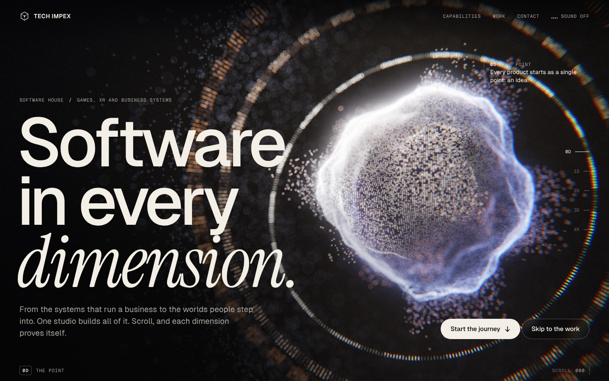
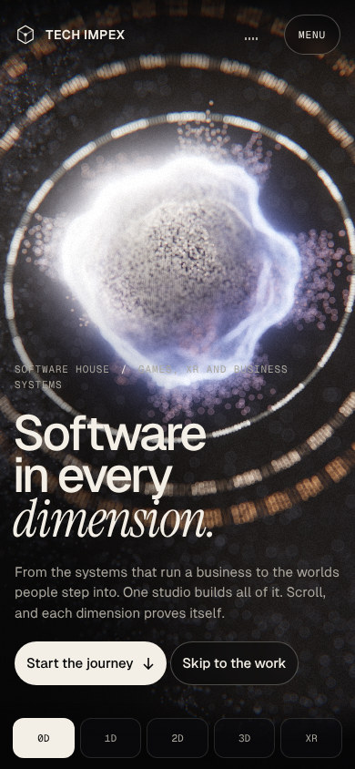

# Tech Impex: Dimensions

"Software in every dimension." A website concept for a software house, built as one scroll journey. About 86,000 GPU particles reshape as you scroll, and each shape proves a capability.



| Dimension | What you see | What it shows the studio can build |
|---|---|---|
| 0D, the point | A living particle core | The idea (hero) |
| 1D, the line | One line that becomes lines of code | Engineering process |
| 2D, the surface | A wall where every particle is a pixel of a live interface, then a working sales system | Web apps, mobile apps, internal management systems, CRM, sales management, analytics dashboards |
| 3D, the world | The surface lifts into terrain, with a playable 30 second game | Game development |
| XR | An AR floor to place furniture on, a VR sphere, a mixed reality room | AR, VR, XR |

After the journey there is a capabilities list, a project gallery and a contact section.

## What is in this repo

| Path | What it is |
|---|---|
| `index.html` | The desktop build. One file, ready to open or host. |
| `mobile.html` | The phone build of the same journey. One phone-sized stage, a bottom bar to jump between dimensions, tapping instead of dragging, lighter rendering (about 31,000 particles). On a desktop it shows inside a phone frame. |
| `src/` | Sources for the desktop build |
| `src-mobile/` | Sources for the phone build |
| `build.cjs` | Rebuilds both HTML files from the sources |
| `docs/` | Screenshots used on this page |



## Open it

Open `index.html` (or `mobile.html`) in a browser. There is nothing to install. It needs an internet connection for three.js (from cdnjs) and the fonts (from Google Fonts).

Each page is a single static file, so any static host will serve it. `index.html` does not send phones to `mobile.html` by itself: link to it, or add a redirect, if you want phones to get the phone build.

## Change it

Edit the files in `src/` or `src-mobile/`, then rebuild:

```
node build.cjs
```

The scripts in `js/` are joined in file name order into one script, so they share one scope and the numbers in the names set the load order. `body.html` is the page markup and `style.css` the styles. The build needs Node and nothing else.

## Placeholder content to replace

Everything shown is sample content.

- **Studio name:** `STUDIO` at the top of `js/00-util.js` (in both source folders).
- **Capabilities and projects:** the `CAPS` and `PROJ` lists in `js/80-work.js`.
- **Contact details:** the email, phone and city near the end of `body.html`.
- **Sales system demo data:** `js/70-demo.js`.

## Notes

- Built on three.js r128 with hand-written shaders. Fonts: Geist, Geist Mono, Instrument Serif.
- If WebGL is not available the page falls back to readable content.
- Sound is off until the visitor turns it on.
- AR and VR are simulated inside the page. There is no camera or headset access yet.
- Tested in a desktop browser engine at desktop, tablet and phone sizes with software rendering. It has not been tested on a physical phone yet.
